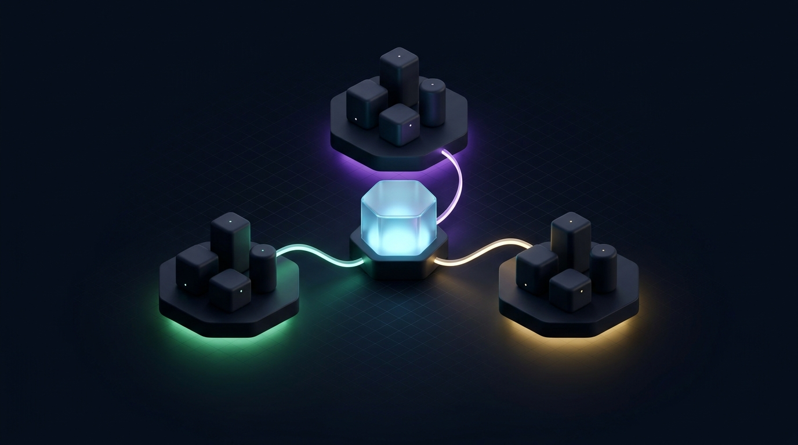

# platform

<p align="center"></p>

A cloud-agnostic Kubernetes platform. **Cluster API** creates and upgrades k3s clusters on Docker, AWS or Hetzner.
**Argo CD** installs the platform addons on all of them from one catalog. **External Secrets Operator** delivers every
credential. **OpenChoreo** is the developer platform on top: projects, components, environments, builds, promotion.
Runtime: Cilium, Istio ambient, kgateway, Kyverno, Falco; telemetry goes to OpenChoreo's observability plane. Opt-in:
external-dns (Route 53 / Cloudflare), OpenChoreo's RCA and FinOps AI agents, and data services (PostgreSQL as a service
through Crossplane v2 - CloudNativePG, RDS, Cloud SQL or Azure Flexible Server per cluster -, Strimzi Kafka, KEDA).

Why: one management cluster, one git repo and one file per cluster give every cluster the same addons, identities and
policies, on any provider, without imperative steps after bootstrap.


### Diagrams

Animated SVGs (motion stops with the OS "reduce motion" setting). Click a view for full size; all of them, plus
[cluster lifecycle](docs/diagrams/cluster-lifecycle.svg), are explained in [docs/diagrams/](docs/diagrams/README.md).

| | |
|---|---|
| [](docs/diagrams/security.svg)<br>**Security**: identity & trust, secrets, supply chain, admission, runtime | [](docs/diagrams/network.svg)<br>**Network**: kgateway, Istio ambient, Cilium / flannel, paths to mgmt |
| [](docs/diagrams/observability.svg)<br>**Observability**: collectors, OpenSearch, Prometheus, observer API | [](docs/diagrams/sdlc.svg)<br>**SDLC**: build, sign, GitOps hand-off, gated promotion |

## Quick start (local)

Needs Docker and [mise](https://mise.jdx.dev); `mise install` installs every other tool at the version pinned in
[`mise.toml`](mise.toml). macOS, Linux and Windows (WSL2 or Git Bash), amd64 and arm64: [docs/dev-environment.md](docs/dev-environment.md).

```bash
mise install  # pinned toolchain (`task doctor` checks it)
task up       # k3d mgmt cluster, seed secrets, Argo CD, root Application; Argo CD does the rest
task status   # CAPI clusters, Argo CD apps, ClusterDataPlanes, how to read the Argo CD admin password
task down     # freeze Argo CD, delete the CAPD workload clusters, then the k3d mgmt cluster
```

To run it from your own copy: `gh repo fork koorikla/platform --clone`, then `task set-repo REPO=<your fork URL>`
([docs/forking.md](docs/forking.md): credentials, boot, troubleshooting). `task --list` shows every entrypoint;
`make <target>` is a shim for `task <target>`.

Offline validation, required before every push: `task lint` and `task test`.

## Documentation

| Doc | Topic |
|---|---|
| [docs/architecture.md](docs/architecture.md) | design and decisions: push GitOps, one file per cluster, addon catalog, trust, secrets, installations, tenants |
| [docs/conventions.md](docs/conventions.md) | contracts every change keeps: invariants, labels, names, secret keys, layout, current practice |
| [AGENTS.md](AGENTS.md) | working rules for AI agents and contributors (CLAUDE.md and GEMINI.md point to it) |
| [docs/providers.md](docs/providers.md) | Cluster API: k3s on CAPD, CAPA, CAPH; adding a cluster; control plane sizing |
| [docs/openchoreo.md](docs/openchoreo.md) | OpenChoreo planes, plane trust, local networking, tenants, app repo contract |
| [docs/project-templates.md](docs/project-templates.md) | golden-path project templates (Backstage scaffolder): Go, Python, Node.js, Rust, Java, Docker |
| [docs/build-plane.md](docs/build-plane.md) | in-cluster builds (OpenChoreo workflow plane) and the Harbor registry |
| [docs/promotion.md](docs/promotion.md) | development -> staging -> production gates |
| [docs/supply-chain.md](docs/supply-chain.md) | signatures, attestations, admission, git and chart verification |
| [docs/networking.md](docs/networking.md) | Cilium, Istio ambient, Gateway API, Kyverno |
| [docs/multicluster.md](docs/multicluster.md) | opt-in Istio ambient multicluster: east-west gateways, remote secrets, mesh CA in OpenBao on mgmt |
| [docs/observability.md](docs/observability.md) | observability plane, telemetry, Datadog, Falco and Falco response |
| [docs/dns.md](docs/dns.md) | external-dns: DNS provider per installation, opt-in per cluster, credentials |
| [docs/data-services.md](docs/data-services.md) | opt-in PostgreSQL as a service (Crossplane v2 XR: CloudNativePG / RDS / Cloud SQL / Azure Flexible Server), CloudNativePG (PostgreSQL + backups), Strimzi (Kafka, KRaft), KEDA; consuming them from OpenChoreo |
| [docs/ai-agents.md](docs/ai-agents.md) | OpenChoreo RCA and FinOps agents, agentgateway, OpenCost (switched off) |
| [docs/demo.md](docs/demo.md) | scripted full-platform demo (~30 min) and its read-only pre-flight `task demo:check` |
| [docs/forking.md](docs/forking.md) | run it from your own fork: `set-repo`, least-privilege credentials, boot, troubleshooting |
| [docs/dev-environment.md](docs/dev-environment.md) | toolchain (mise + Task), hosts, portable scripts, image architecture audit |
| [docs/diagrams/](docs/diagrams/README.md) | architecture, security, network, observability, SDLC, cluster lifecycle |

Related repos: [koorikla/hello-world](https://github.com/koorikla/hello-world) (example app),
[koorikla/ci](https://github.com/koorikla/ci) (reusable CI workflows and build scripts).

## Status

Diagram boxes: solid = built on `main`, dashed = opt-in (on `main`, off by default), dimmed with a "planned" tag = not on `main` yet.

| State | What |
|---|---|
| **Built, running locally** | k3d mgmt + CAPD clusters `dev1` (Cilium) and `prod1` (flannel) from fleet files; Argo CD push mode with the addon catalog; ESO stores; per-cluster OpenChoreo agent identity; OpenChoreo control plane, Thunder, Backstage, data planes; hello-world released to `development`; observability plane with workload telemetry; Falco + falcosidekick + Talon; Istio ambient with app namespaces enrolled by Kyverno; Kyverno Pod Security baseline (Audit) |
| **Built, first live run pending** | workflow plane builds + Harbor ([#40](https://github.com/koorikla/platform/issues/40), [#17](https://github.com/koorikla/platform/issues/17)); promotion gates ([#10](https://github.com/koorikla/platform/issues/10), [#11](https://github.com/koorikla/platform/issues/11), [#54](https://github.com/koorikla/platform/issues/54)); per-environment image verification ([#15](https://github.com/koorikla/platform/issues/15), [#16](https://github.com/koorikla/platform/issues/16)); Falco escalation to Argo Events |
| **Built, rendered only** | AWS (CAPA) and Hetzner (CAPH) installations, AWS Secrets Manager / Vault backends ([#26](https://github.com/koorikla/platform/issues/26)); Istio ambient multicluster between `dev1` and `prod1` with the mesh CA in OpenBao on mgmt ([#19](https://github.com/koorikla/platform/issues/19), [docs/multicluster.md](docs/multicluster.md)) |
| **Opt-in** | OBI (eBPF RED metrics), Datadog exporter, Talon dry run per environment; external-dns (Route 53 / Cloudflare; live check [#21](https://github.com/koorikla/platform/issues/21)); OpenChoreo RCA and FinOps agents + agentgateway + OpenCost ([#22](https://github.com/koorikla/platform/issues/22)); data services PostgreSQL as a service (Crossplane v2; rendered offline, live check [#107](https://github.com/koorikla/platform/issues/107)), CloudNativePG, Strimzi (Kafka), KEDA ([docs/data-services.md](docs/data-services.md); OpenChoreo resource types [#70](https://github.com/koorikla/platform/issues/70)) |
| **Planned** | argocd-agent managed mode ([#20](https://github.com/koorikla/platform/issues/20)); Crossplane v2 with gated package promotion ([#57](https://github.com/koorikla/platform/issues/57)); SSO ([#58](https://github.com/koorikla/platform/issues/58)); Backstage scaffolder ([#59](https://github.com/koorikla/platform/issues/59)); Istio multicluster east-west ([#18](https://github.com/koorikla/platform/issues/18)) |

Backlog: [open issues](https://github.com/koorikla/platform/issues).
