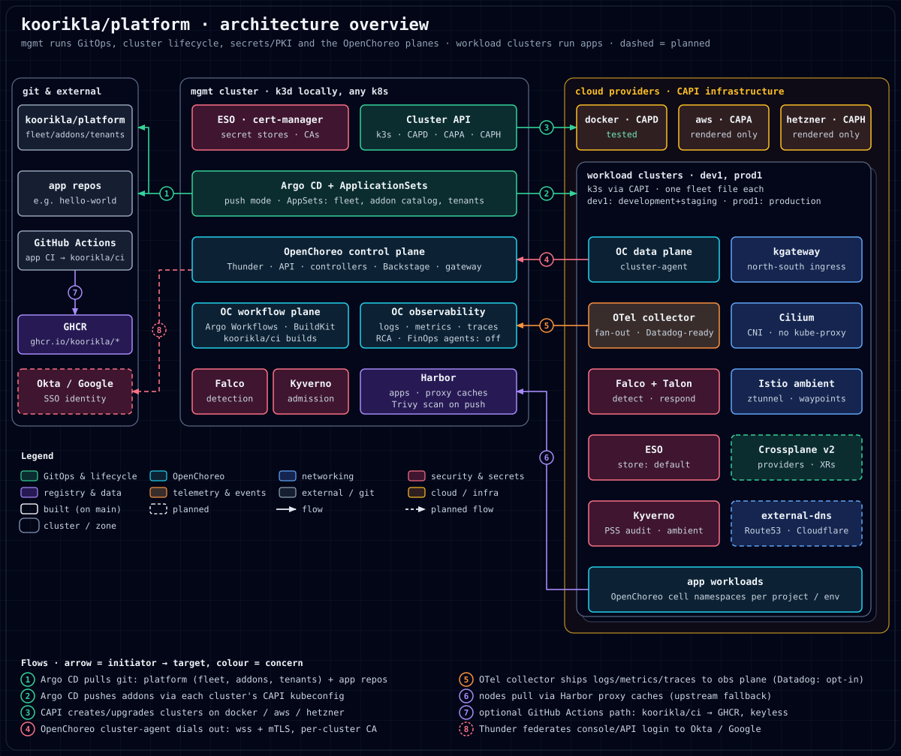

# platform

<p align="center"></p>

A cloud-agnostic Kubernetes platform: **Cluster API** creates and lifecycles k3s clusters on Docker, AWS or Hetzner,
**Argo CD** installs the platform add-ons on all of them from one catalog, **External Secrets Operator** moves every
credential, and **OpenChoreo** is the developer platform on top (projects, components, environments, promotion).
Runtime: Cilium, Istio ambient, kgateway, Kyverno, Falco; telemetry to OpenChoreo's observability plane (Datadog-ready).



| Read | For |
|---|---|
| [docs/architecture.md](docs/architecture.md) | design and decisions (why push GitOps, trust model, secrets, installations, tenants) |
| [docs/conventions.md](docs/conventions.md) / [AGENTS.md](AGENTS.md) | invariants, labels, names - the contracts every change keeps |
| [docs/diagrams/](docs/diagrams/README.md) | cluster lifecycle, trust model, delivery, runtime security |
| [docs/providers.md](docs/providers.md), [docs/openchoreo.md](docs/openchoreo.md), [docs/networking.md](docs/networking.md), [docs/observability.md](docs/observability.md) | per-area details |

Related repos: [koorikla/hello-world](https://github.com/koorikla/hello-world) (example app), [koorikla/ci](https://github.com/koorikla/ci) (reusable CI workflows).

**Status:** the local installation boots end to end (k3d mgmt, two CAPD clusters, OpenChoreo agents connected through
per-cluster certificates, hello-world released to `development` by OpenChoreo). AWS and Hetzner render and validate
but have not been booted. Networking, policy, build plane, Crossplane and SSO are in progress.

## Prerequisites

- `kubectl`, `helm` (with `helm-unittest` plugin for tests), `yq`, `kubeconform`
- Local installation (`INST=local`): `docker`, `k3d`, `gh` (authenticated; add `read:packages` only if your GHCR images are private)

## Local quickstart

```bash
# Point repoURL at your fork if needed:
# make set-repo REPO=https://github.com/<you>/platform.git

make up       # Create k3d platform-mgmt (network: kind, loopback ports 8080/8443/11080/11085), seed secrets, install Argo CD, apply root-app
make status   # Check CAPI clusters, Argo CD apps, ClusterDataPlanes, UI port-forward + admin password
make down     # Delete CAPD workload clusters gracefully, then delete k3d platform-mgmt
```

Individual bootstrap stages:

- `make secrets` — seed or refresh `platform-secrets` (`platform-github`, `platform-ghcr`, `openchoreo`) from `gh` CLI (preserves existing `openchoreo` secret keys)
- `make argocd` — install/upgrade Argo CD (`addons/argo-cd`) and apply `bootstrap/root-app.yaml`

## Cloud installations (AWS / Hetzner)

`installations/aws-example` and `installations/hetzner-example` target any existing management cluster in your current kubeconfig context:

```bash
make up INST=aws-example
# or
make up INST=hetzner-example
```

When `secrets.backend` is not `kubernetes`, `bootstrap.sh` skips k3d creation and local `platform-secrets` seeding, installs Argo CD with `addons/argo-cd/values.yaml`, optionally seeds the bootstrap repo secret from `GITHUB_USER`/`GITHUB_TOKEN` if set, and applies `root-app.yaml` pointing at `installations/<inst>/installation.yaml`.

## Adding clusters, addons, and tenants

- **Workload cluster**: add `installations/<inst>/clusters/<name>.yaml` (see `charts/cluster/values.yaml`). `ApplicationSet/fleet` deploys `charts/cluster` to provision the CAPI `Cluster`, register the Argo CD cluster secret via `ExternalSecret`, and register the OpenChoreo `ClusterDataPlane` + `Environment`.
- **Addon**: add `addons/<name>/` (wrapper `Chart.yaml` + `values.yaml` + optional `values/role-*.yaml`, `values/provider-*.yaml`) and register it in `charts/platform/values.yaml`.
- **Tenant**: add `installations/<inst>/tenants/<project>.yaml` (reconciled by `ApplicationSet/tenants`).

## Offline validation

```bash
make lint     # Build chart deps, helm lint all charts, validate YAML + shellcheck
make test     # Full offline validation: helm template across all installations/clusters, kubeconform -strict, helm unittest, contract tests
```
