# platform

A cloud-agnostic Kubernetes developer platform reconciled from Git with zero imperative steps after bootstrap. This repo is a
**local platform lab**: everything is built and proven on Docker (`k3d` + Cluster API's Docker provider). The developer-facing
layer runs on any conformant Kubernetes; only the infrastructure layer (CNI, storage, cloud controller, load balancer, CA
backend) changes per provider - see [docs/portability.md](docs/portability.md).

- **Cluster API (CAPI)** provisions and upgrades workload clusters from one file per cluster. Locally that is k3s on Docker
  (CAPD). CAPI has providers for practically every cloud and on-prem target (AWS, Azure, GCP, vSphere, OpenStack, Proxmox,
  bare metal via Metal3, Hetzner, ...); the AWS, Hetzner and GKE ClusterClasses here are **untested examples** of that.
  Existing clusters can also be registered without CAPI (`provider: byo`).
- **Argo CD** pushes platform addons from a single label-driven catalog on the management cluster (`mgmt`) to every workload cluster.
- **OpenChoreo** provides the developer platform on top: Golden-path Backstage templates, projects, environments, in-cluster BuildKit
  builds into Harbor (auto-triggered on push), PR preview environments, and gated GitOps promotion.
- **External Secrets Operator (ESO)** delivers every credential and CA bundle from a pluggable secret backend (`kubernetes` and
  per-tenant OpenBao stores locally; a cloud secret manager or Vault/OpenBao elsewhere).
- **Certificates are pluggable too.** Locally, OpenBao (the open-source Vault fork) on `mgmt` is the mesh CA, consumed by
  cert-manager/istio-csr so CA keys never leave `mgmt`. In a cloud you would typically point the same cert-manager issuer
  contract at a managed CA instead (AWS Private CA, Google CAS, Azure Key Vault, or an existing Vault).



## Quick start

Requires Docker and [mise](https://mise.jdx.dev) on Linux, macOS, or Windows (WSL2 or Git Bash, `amd64` / `arm64`; see [docs/dev-environment.md](docs/dev-environment.md)).

```bash
mise install      # install the pinned toolchain (`task doctor` verifies host prerequisites)
task up           # boot k3d mgmt, seed local secrets, install Argo CD, and apply Application/root
task status       # inspect CAPI clusters, Argo CD apps, and OpenChoreo ClusterDataPlanes
task demo:check   # read-only pre-flight across every plane and workload cluster
task down         # freeze Argo CD, delete CAPD workload clusters, then delete k3d mgmt
```

Run from your own fork: `gh repo fork koorikla/platform --clone`, then `task set-repo REPO=<your-fork-url>` ([docs/forking.md](docs/forking.md)). Offline validation before pushing: `task lint` and `task test` (`task --list` lists every target). Golden-path templates that create repos need a GitHub org and the platform write GitHub App: [repository creation](docs/project-templates.md#repository-creation).

## 9-step demo storyline

Full walkthrough (~30 minutes) and talking points: **[docs/demo.md](docs/demo.md)**.

1. **Clean bootstrap**: `task up` brings up `mgmt` and reconciles the entire platform from `bootstrap/root-app.yaml`.
2. **Add a cluster by adding a file**: commit `installations/<inst>/clusters/<name>.yaml`; CAPI boots the cluster, Argo CD installs its addons, and OpenChoreo connects its data-plane agent.
3. **Developer self-service**: scaffold a new repository from a Backstage golden-path template under a tenant project.
4. **Build and supply chain**: build multi-arch container images on the OpenChoreo workflow plane (or [`ci/`](ci/)), attach SBOM and SLSA provenance, and sign with Cosign.
5. **Deploy and promote**: roll out [koorikla/hello-world](https://github.com/koorikla/hello-world) across `development -> staging -> production`, gated on `production` by automated HTTP + 5xx SLO checks and a reviewed Git PR.
6. **Observe**: query logs, traces (OpenSearch), metrics (Prometheus), and Hubble network flows from `mgmt`.
7. **Runtime security**: detect container anomalies with modern-eBPF Falco, quarantine or terminate pods with Talon, and escalate critical alerts to Argo Events.
8. **Zero trust**: enforce sidecarless mTLS with Istio ambient (backed across clusters by OpenBao's mesh CA) and admission policy with Kyverno.
9. **App with a database**: provision PostgreSQL through one Crossplane v2 API, backed by CloudNativePG locally (or on any cluster) or, as untested examples, cloud-managed RDS, Cloud SQL, or Flexible Server.

## Diagrams

Animated SVGs pause automatically when the OS prefers reduced motion. Step-by-step walkthroughs: [docs/diagrams/](docs/diagrams/README.md).

| | |
|---|---|
| [](docs/diagrams/security.svg)<br>**Security**: supply chain, admission, runtime | [](docs/diagrams/network.svg)<br>**Network**: a request in, its telemetry out |
| [](docs/diagrams/observability.svg)<br>**Observability**: collectors, stores, one query API | [](docs/diagrams/sdlc.svg)<br>**SDLC**: build, sign, promote, admit |

Day-2 operations:

| | |
|---|---|
| [](docs/diagrams/cluster-lifecycle.svg)<br>**Cluster lifecycle**: add, upgrade, remove = edit one file | [](docs/diagrams/trust.svg)<br>**Trust & certificates**: agent CAs, OpenBao mesh CA, renewal |
| [](docs/diagrams/backup.svg)<br>**Backup & restore**: the restore order | [](docs/diagrams/upgrade.svg)<br>**Upgrades**: Renovate → CI → merge → Argo CD, dev before prod |

## Repository map

```text
bootstrap/              k3d mgmt config, bootstrap.sh (task up / down), local secret seeding, root-app.yaml
charts/                 platform (root catalog + ApplicationSets), cluster (one workload cluster), tenant (one project)
addons/                 38 platform and wrapper charts (each with its own README.md, Chart.yaml, and values.yaml)
installations/          per-installation overlays, fleet files (clusters/*.yaml), and tenant files (tenants/*.yaml)
templates/              Backstage golden-path scaffolder templates + app repo skeletons
docs/                   concept guides, day-2 operations handbook (docs/operations.md), runbooks/, and diagrams/
hack/                   portable tooling, linters, and offline contract tests (hack/tests/)
mise.toml, Taskfile.yml pinned cross-platform CLI versions and Task entrypoints
```

## Documentation

- **Core design & contracts**: [Architecture](docs/architecture.md), [Conventions and contracts](docs/conventions.md), [AGENTS.md](AGENTS.md)
- **For AI agents only**: [LLM wiki](wiki/README.md) (agent working memory; not human documentation, may be stale)
- **Clusters & networking**: [Portability (what differs per provider)](docs/portability.md), [Cluster API providers and bring-your-own clusters](docs/providers.md), [Networking and Kyverno](docs/networking.md), [Multicluster mesh & OpenBao CA](docs/multicluster.md), [External DNS](docs/dns.md)
- **Developer platform & delivery**: [DevOps guide (delivery lanes, extension points, app + database map, recipes)](docs/devops-guide.md), [OpenChoreo](docs/openchoreo.md), [Reference: component types, traits, resource types, workflows, platform APIs (generated)](docs/reference/README.md), [Golden-path templates](docs/project-templates.md), [Build plane & Harbor](docs/build-plane.md), [Promotion gates](docs/promotion.md), [PR preview environments](docs/preview-environments.md), [Supply chain](docs/supply-chain.md), [Releases](docs/releases.md)
- **Observability, data & AI**: [Observability & Falco](docs/observability.md), [Data services (CNPG, Strimzi, KEDA, PostgreSQL API)](docs/data-services.md), [Crossplane platform APIs](docs/crossplane.md), [AI agents](docs/ai-agents.md)
- **Contributing & forks**: [Developer environment](docs/dev-environment.md), [Running from a fork](docs/forking.md)

## Day-2 operations

Start at the **[Day-2 operations handbook](docs/operations.md)** for cluster access rules and triage entrypoints:

- [Upgrades](docs/runbooks/upgrades.md): k3s, CAPI, `ClusterClass` rollouts, Renovate addon bumps, OpenChoreo, Istio, Kyverno
- [Backup and restore](docs/runbooks/backup-restore.md): `mgmt` and workload `etcd`, OpenBao (`raft` + unseal key), Thunder PVCs, Harbor, CloudNativePG
- [Certificates and secrets](docs/runbooks/certificates-and-secrets.md): cert-manager CAs, OpenBao mesh CA, OpenChoreo agent certs, GitHub Apps, Cosign, ESO
- [Scaling and capacity](docs/runbooks/scaling-and-capacity.md): adding or decommissioning clusters, worker pools, `1` vs `3` server HA, local RAM profiles
- [Incidents](docs/runbooks/incidents.md): stuck Argo apps, unreachable clusters, blocked promotion gates, Kyverno denials, Falco alerts, sealed OpenBao
- [Observability first look](docs/runbooks/observability-first-look.md): 5-minute triage across Backstage, OpenSearch, Prometheus, and Hubble
- [Break-glass](docs/runbooks/break-glass.md): freezing Argo CD `selfHeal`, emergency promotion overrides, `etcd` quorum recovery, OpenBao local reset
