# Architecture

A cloud-agnostic platform built from four parts:

| Part | Job |
|---|---|
| **Cluster API** (k3s bootstrap + control plane provider; CAPD, CAPA, CAPH infra) | creates and upgrades every workload cluster from one file in git |
| **Argo CD** (on mgmt only, push mode) | installs platform addons on mgmt and on every workload cluster; syncs OpenChoreo resources into the control plane |
| **External Secrets Operator** | moves every credential: repo creds, cloud creds, CAPI kubeconfigs into Argo CD cluster secrets, OpenChoreo agent identities into workload clusters, app secrets on data planes |
| **OpenChoreo** (control plane, workflow and observability planes on mgmt; a data plane per workload cluster) | the developer platform: Projects, Components, Environments, builds, promotion; it delivers app workloads to data planes itself |

Contracts (invariants, labels, names): [conventions.md](conventions.md). Diagrams: [diagrams/](diagrams/README.md). Day-2 operations: [operations.md](operations.md). How things ship day to day: [devops-guide.md](devops-guide.md).

## Topology



The numbered steps are listed in [diagrams/README.md](diagrams/README.md#steps). Not drawn:
External Secrets Operator (credentials, below), cert-manager (agent certificates, [Trust between OpenChoreo
planes](#trust-between-openchoreo-planes)) and the OpenChoreo workflow and observability planes, which run on mgmt
next to the control plane ([build-plane.md](build-plane.md), [observability.md](observability.md)).

## Decisions

### Push mode: no Argo CD component on workload clusters
CAPI already needs mgmt -> workload API reachability (it reconciles nodes, reads the kubeconfig, drains machines), so
Argo CD on mgmt pushing through the CAPI kubeconfig adds no new network path. App delivery does not go through Argo CD
on data planes at all: OpenChoreo's cluster-agent dials **out** to the control plane and applies releases. A cluster
behind a NAT where mgmt cannot reach its API cannot be CAPI-managed from this mgmt either, so that case is out of scope.

Planned: argocd-agent in managed mode, so addon delivery is pulled by an agent per cluster and mgmt holds no workload
admin kubeconfigs ([#20](https://github.com/koorikla/platform/issues/20)). Catalog and label targeting stay as they
are; the agent's client cert would reach each cluster over the same ClusterResourceSet path as the OpenChoreo agent
identity.

### Adding a cluster = adding one file
`installations/<inst>/clusters/<name>.yaml` -> ApplicationSet `fleet` (git files generator) -> Application
`cluster-<name>` -> chart `charts/cluster`, which renders on mgmt:

1. CAPI `Cluster` (topology, class `k3s-<provider>`), labelled with the cluster facts.
2. ExternalSecret -> Argo CD cluster secret (built from CAPI's `<name>-kubeconfig`), with the same labels.
   This is the hand-off: as soon as the kubeconfig exists, every addon ApplicationSet whose selector matches the
   labels generates an Application for the new cluster.
3. OpenChoreo identity (if `openchoreo.dataPlane.enabled`): per-cluster agent CA + client cert, delivered by a CAPI
   `ClusterResourceSet`; `ClusterDataPlane <name>` trusting that CA; `Environment`s bound to it.

Removing the file deletes the cluster (Argo CD prune -> CAPI delete) and all its registrations.

Rejected for step 2: [capi2argo-cluster-operator](https://github.com/dntosas/capi2argo-cluster-operator) (an extra
controller, built on CAPI 1.10/v1beta1, lightly maintained, labels copied after the fact). Its one advantage is
picking up clusters created outside git; if self-service cluster creation ever lands, it can replace the
ExternalSecret (`ENABLE_AUTO_LABEL_COPY=true`) as a mgmt addon.

Details (fleet file fields, ClusterClasses, control plane sizing): [providers.md](providers.md).

### Addons: catalog + labels (GitOps-Bridge style)
`charts/platform` renders one ApplicationSet per catalog entry (`charts/platform/values.yaml` `addons`). Each uses a
cluster generator selecting on `platform.koorikla.io/role` (and optionally provider) plus the opt-in/opt-out label
`addons.platform.koorikla.io/<addon>`. Values are layered by Helm value files (missing files ignored):

```
addons/<other>/values.yaml                                   catalog valuesFromAddons: facts read from another addon
addons/<addon>/values.yaml                                   chart defaults (all clusters)
addons/<addon>/values/role-<role>.yaml                       mgmt vs workload
addons/<addon>/values/provider-<provider>.yaml               docker vs aws vs hetzner
addons/<addon>/values/cni-<cni>.yaml                         cilium vs flannel (label platform.koorikla.io/cni)
addons/<addon>/values/<catalog installationValueFiles>       by installation fact (e.g. external-dns dns-<dns.provider>)
installations/<inst>/addons/<addon>/values.yaml              this installation
installations/<inst>/addons/<addon>/env-<environment>.yaml   this environment
installations/<inst>/addons/<addon>/cluster-<name>.yaml      this cluster (identity / exceptions only)
```

plus generated `cluster.*` values (name, role, provider, region, environment, cni) and `installation.*` values.
`valuesFromAddons` lets one addon derive facts from another's single source instead of restating them (kyverno-policies
reads addons/cloudnative-pg's image pins; installation overlays of the other addon are not read, so they fail closed).
Catalog entries can add Helm parameters computed per cluster: `clusterNameParameters` (the cluster name),
`clusterIdParameters` (`<installation>-<cluster>`, unique across installations, e.g. the external-dns TXT owner),
`installationParameters` (a template over installation values), `clusterServerParameters` (`url`, `host` or `port`
of the cluster secret's API server, e.g. Cilium's `k8sServiceHost`; [networking.md](networking.md)),
`clusterLabelParameters` (a cluster secret label's value with a default, e.g. Istio's meshID and network from the mesh
labels; [multicluster.md](multicluster.md)), `clusterNameFormats` (the cluster name inside fixed text, e.g.
falcosidekick's `cluster:<name>` custom field) and `fleetParameters` (every platform cluster's name as a Helm list: the
ApplicationSet matrixes its cluster generator with a `flatList` one over all cluster secrets, e.g. argo-events'
per-cluster Falco endpoints). `installationValueFiles`
(templates over installation values, paths under `addons/<addon>/values/`) select value files by an installation fact
that is not a cluster label, e.g. external-dns' DNS provider ([dns.md](dns.md)). `hack/lib/addons.sh` reproduces this
layering for every offline render (test.sh, image-audit, contract tests), reading the release name, value files,
`valuesObject` and parameters from the rendered ApplicationSet (`hack/tests/test_addon_renderer.sh`).

Argo CD diffs server-side (`controller.diff.server.side`). `compareOptions` sets an Application's
`argocd.argoproj.io/compare-options`. Addons that render Argo Workflows objects (ClusterWorkflowTemplate,
WorkflowTemplate, CronWorkflow) need `IncludeMutationWebhook=true`. Those CRDs declare `spec` atomic +
preserve-unknown, and without the option server-side diff reports Synced while the live spec stays old (#184).
`hack/tests/test_argocd_compare_options.sh`
fails if an addon renders such a kind without the option, or sets it without one. Immutable-spec kinds
(PriorityClass, StorageClass) live in an addon with `ServerSideDiff=false`, or a changed field deadlocks the dry
run ([conventions](conventions.md#immutable-fields), #281).

Version pinning per cluster ring: the cluster secret annotation `platform.koorikla.io/addons-revision` (fleet file
`addonsRevision`, default `HEAD`) is the `targetRevision` of that cluster's addon Applications, so prod can follow a
tag while dev follows `main`. Kargo could replace this later; it is deliberately not part of v1.

### Trust between OpenChoreo planes
The upstream multi-cluster recipe is imperative (copy the agent's self-signed CA back to the control plane) or copies
the control plane's CA **private key** into every plane. Neither is acceptable. Here each workload cluster gets its own
agent CA on mgmt that signs exactly one client cert (`CN=<name>`); `ClusterDataPlane <name>` trusts only that CA, so a
compromised cluster cannot impersonate another plane, and deleting the CA revokes the cluster. The client cert and the
control plane's public gateway CA reach the cluster through a CAPI `ClusterResourceSet` whose payload ESO templates:
no script, no mgmt -> workload write outside CAPI. Details: [openchoreo.md](openchoreo.md#trust-model).

### Secrets: one store name, pluggable backends
Every ExternalSecret on mgmt references `ClusterSecretStore/platform`. Its backend is per installation:

| Backend | Use |
|---|---|
| `kubernetes` | local stand-in: secrets in mgmt namespace `platform-secrets`, seeded by `task secrets` ([forking.md](forking.md#seeding-locally-task-secrets)) |
| `aws` | AWS Secrets Manager (IRSA / Pod Identity) |
| `vault` | Vault / OpenBao (Hetzner and other clouds without a native secret manager) |

Workload clusters get `ClusterSecretStore/default` (OpenChoreo `secretStoreRef`) with the same backend choice; it
refuses tenant (cell) namespaces while `secrets.tenantStores.enabled`. App secrets come from OpenBao instead: each cell
namespace gets `SecretStore openbao-tenant`, which reads only that project's mount, and apps point at a key with an
OpenChoreo `SecretReference` ([openchoreo.md](openchoreo.md#application-secrets-developer-view)). The external-dns
Cloudflare token has its own `ClusterSecretStore/dns` (namespace `external-dns` only, separate backend location and
identity; [dns.md](dns.md#credentials)).
Key names are flat (`platform-github`, `capi-aws`, …; [conventions.md](conventions.md#secret-keys)) so they map onto
every backend. `platform` holds every platform credential, so its `spec.conditions` admit only the mgmt namespaces
that consume it (addon secret-stores `platformStore.namespaces`), while `workflows-*` run namespaces use the
key-scoped `ClusterSecretStore/workflows`; `hack/tests/test_secret_store_scope_chart.sh` fails when a
rendered consumer is missing from that list, `hack/tests/test_secret_store_scope.sh` when a listed namespace has no
consumer.

### Installations
`installations/<inst>/` is one mgmt cluster and its fleet: `installation.yaml` (domain, secret backend, enabled CAPI
providers, OpenChoreo endpoints, registry, promotion), `clusters/`, `addons/` overrides, `tenants/`. `local` is the
booted one; `aws-example`, `hetzner-example` and `gcp-example` (GKE) are reference installations that render but have
not been booted ([#26](https://github.com/koorikla/platform/issues/26),
[#87](https://github.com/koorikla/platform/issues/87)).

Local: mgmt is the k3d cluster `platform-mgmt` on Docker network `kind` (shared with CAPD), docker.sock mounted for
CAPD. The workload cluster is the CAPD k3s cluster `dev1`, hosting the environments development, staging and production
as namespaces; the multicluster profile adds `prod1` for production ([dev-environment.md](dev-environment.md#local-profiles)).

### Tenants (OpenChoreo apps)
App repos own their OpenChoreo manifests (`deploy/openchoreo/`: Component, Workload, ReleaseBindings). The platform repo
registers them: `installations/<inst>/tenants/<project>.yaml` -> OpenChoreo `Project` + one Argo CD Application per
app repo, in AppProject `tenant-<project>` restricted to that repo and to OpenChoreo developer kinds. Onboarding an app
is one file in the platform repo; deploying and promoting are commits in the app repo
([openchoreo.md](openchoreo.md#tenants), [promotion.md](promotion.md)).

### Platform APIs: Crossplane Configuration packages, next to the app
Databases and other platform APIs are Crossplane v2 XRs on the workload cluster that runs the app (opt-in per cluster).
Each API (XRD + Composition) ships as a digest-pinned Configuration package built from `packages/<name>/` (signed in CI;
in-cluster verification is off until Crossplane reads Sigstore bundles, #247);
per-cluster facts reach it through an `EnvironmentConfig`, so one package serves every provider. Developers ask through
OpenChoreo (resource type `postgresql`), never through Crossplane directly ([crossplane.md](crossplane.md),
[data-services.md](data-services.md)).

### Builds in the cluster, not in a CI provider
Components name a ClusterWorkflow; the OpenChoreo workflow plane on mgmt builds, scans, signs and commits the new image
ref to the app repo, and Argo CD deploys it. The reusable GitHub Actions workflows (`.github/workflows/app-*.yaml`,
scripts in [`ci/`](../ci/README.md)) run the same scripts as an optional path. This keeps CI providers thin and the
build path identical on every installation ([build-plane.md](build-plane.md)).

### Repos
| Repo | Owner | Contents |
|---|---|---|
| `koorikla/platform` | platform team | bootstrap, charts, addons, installations (fleet, tenants), OpenChoreo platform config |
| `koorikla/hello-world` | app team | code, Dockerfile, CI, `deploy/openchoreo/` |

Both are public. Private forks work with repo credentials from `platform-github` (ESO -> Argo CD `repo-creds`);
nodes pull private GHCR images with `platform-ghcr` ([forking.md](forking.md#3-credentials)).
