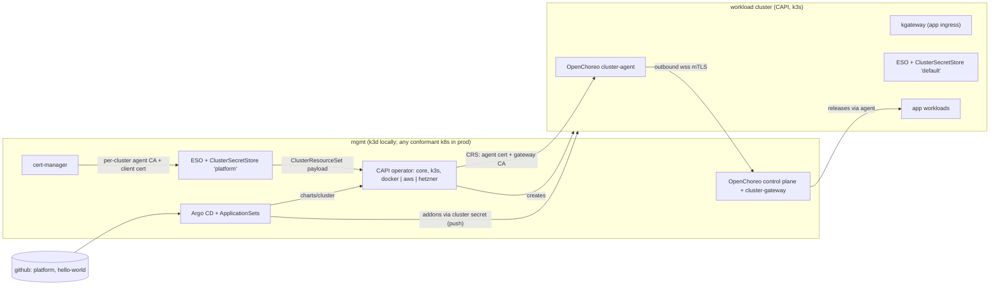

# Architecture

A cloud-agnostic platform built from four parts:

| Part | Job |
|---|---|
| **Cluster API** (k3s bootstrap + control plane provider; CAPD, CAPA, CAPH infra) | creates and lifecycles every workload cluster from one file in git |
| **Argo CD** (on mgmt only, push mode) | installs platform addons on mgmt and on every workload cluster; syncs OpenChoreo resources into the control plane |
| **External Secrets Operator** | the glue for secrets and credentials: repo creds, cloud creds, CAPI kubeconfigs into Argo cluster secrets, OpenChoreo agent identities into workload clusters, app secrets on data planes |
| **OpenChoreo** (control plane on mgmt, data plane per workload cluster) | the developer platform: Projects, Components, Environments, promotion; it delivers app workloads to data planes itself |

## Topology



## Decisions

### No argocd-agent on workload clusters
CAPI already requires mgmt → workload API reachability (it reconciles nodes, reads the kubeconfig, drains machines), so
Argo CD on mgmt pushing through the CAPI kubeconfig adds no new network path. App delivery does not go through Argo at
all on data planes: OpenChoreo's cluster-agent dials **out** to the control plane and applies releases. So workload
clusters run no Argo component. If a future cluster sits behind a NAT where mgmt cannot reach its API, it cannot be
CAPI-managed from this mgmt either; that case is out of scope.

**Next step (decided):** move add-on delivery to pull with argocd-agent in managed mode: the ApplicationSets and the
UI stay on mgmt, an agent per workload cluster dials out and applies locally (resilience to a mgmt outage, scale). The
catalog and label targeting carry over unchanged; the agent's client cert reaches each cluster through the same
ClusterResourceSet path as the OpenChoreo agent identity.

### Adding a cluster = adding one file
`installations/<inst>/clusters/<name>.yaml` → ApplicationSet `fleet` (git files generator) → Application
`cluster-<name>` → chart `charts/cluster`, which renders on mgmt:

1. CAPI `Cluster` (topology, class `k3s-<provider>`), labelled with the cluster facts.
2. ExternalSecret → Argo CD cluster secret (built from CAPI's `<name>-kubeconfig`), carrying the same labels.
   This is the hand-off point: as soon as the kubeconfig exists, every addon ApplicationSet whose selector matches the
   labels generates an Application for the new cluster. Nothing hardcodes cluster names.
3. OpenChoreo identity (if `openchoreo.dataPlane.enabled`): per-cluster agent CA + client cert (cert-manager, on mgmt),
   delivered into the workload cluster by a CAPI `ClusterResourceSet` whose payload ESO templates from those secrets;
   `ClusterDataPlane <name>` trusting that per-cluster CA; `Environment`s bound to it.

Considered and rejected for step 2: [capi2argo-cluster-operator](https://github.com/dntosas/capi2argo-cluster-operator)
(an extra controller, built on CAPI 1.10/v1beta1, lightly maintained, labels copied after the fact). Its one advantage
is picking up clusters created outside git; if self-service cluster creation ever lands, swap the ExternalSecret for it
(`ENABLE_AUTO_LABEL_COPY=true`) as a mgmt addon.

Removing the file deletes the cluster (Argo prune → CAPI delete) and all its registrations with it.

### Addons: catalog + labels (GitOps-Bridge style)
`charts/platform` renders one ApplicationSet per catalog entry. Each uses a cluster generator selecting on
`platform.koorikla.io/role` (and optionally provider) plus the opt-out/opt-in label
`addons.platform.koorikla.io/<addon>`. Values are layered by Helm value files (missing files ignored):

```
addons/<addon>/values.yaml                                   chart defaults (all clusters)
addons/<addon>/values/role-<role>.yaml                       mgmt vs workload
addons/<addon>/values/provider-<provider>.yaml               docker vs aws vs hetzner
addons/<addon>/values/cni-<cni>.yaml                         cilium vs flannel (label platform.koorikla.io/cni)
installations/<inst>/addons/<addon>/values.yaml              this installation
installations/<inst>/addons/<addon>/env-<environment>.yaml   this environment
installations/<inst>/addons/<addon>/cluster-<name>.yaml      this cluster (identity / exceptions only)
```

plus generated `cluster.*` values (name, role, provider, region, environment, cni) and `installation.*` values.
Catalog entries can add Helm parameters computed per cluster: `clusterNameParameters` (the cluster name),
`installationParameters` (a template over installation values) and `clusterServerParameters` (`url`, `host` or `port`
of the cluster secret's API server, e.g. Cilium's `k8sServiceHost`; docs/networking.md).

Version pinning per cluster ring: the cluster secret annotation `platform.koorikla.io/addons-revision` (from the fleet
file, default `HEAD`) is the `targetRevision` of that cluster's addon Applications. Prod can follow a tag while dev
follows `main`. (Kargo can replace this later; it is deliberately not part of v1.)

### Trust between OpenChoreo planes
The upstream multi-cluster recipe is imperative (copy the agent's self-signed CA back to the control plane) or copies
the control plane's CA **private key** into every plane. Neither is acceptable. Here:

- CA private keys never leave mgmt. Each workload cluster gets its **own** agent CA on mgmt (`fleet/<name>-agent-ca`),
  which signs exactly one client cert (`CN=<name>`). `ClusterDataPlane <name>` trusts only that CA, so a compromised
  cluster cannot impersonate another plane, and deleting the CA revokes the cluster.
- The client cert + key and the control plane's **public** gateway CA reach the workload cluster through a CAPI
  `ClusterResourceSet` (strategy `Reconcile`, re-applied on rotation). ESO templates the CRS payload from the cert-manager
  secrets on mgmt (ClusterSecretStore over mgmt's own API), so there is no script and no hub→worker write outside CAPI.
- The data plane chart runs with `generateCerts: true` (its own Certificate goes to an unused secret name) and
  `clientSecretName: cluster-agent-tls` (the delivered one).

### Secrets: one store name, pluggable backends
Every ExternalSecret on mgmt references `ClusterSecretStore/platform`. Its backend is per installation:

| Backend | Use |
|---|---|
| `kubernetes` | local stand-in: secrets in mgmt namespace `platform-secrets`, seeded by `make secrets` |
| `aws` | AWS Secrets Manager (IRSA / Pod Identity) |
| `vault` | Vault / OpenBao (Hetzner and other clouds without a native secret manager) |

Workload clusters get `ClusterSecretStore/default` (OpenChoreo `secretStoreRef`) with the same backend choice.
Key names are flat (`platform-github`, `platform-ghcr`, `capi-aws`, `capi-hetzner`) so they map onto every backend.

### Installations
`installations/<inst>/` is one mgmt cluster and its fleet: `installation.yaml` (domain, secret backend, enabled CAPI
providers, OpenChoreo endpoints), `clusters/`, `addons/` overrides, `tenants/`. `local` is the tested one; `aws-example`
and `hetzner-example` are reference installations that render but are not booted (no credentials).

### Tenants (OpenChoreo apps)
App repos own their OpenChoreo manifests (`deploy/openchoreo/`: Component, Workload, ReleaseBindings). The platform repo
registers them: `installations/<inst>/tenants/<project>.yaml` → OpenChoreo `Project` + one Argo Application per app repo,
in AppProject `tenant-<project>` restricted to that repo and to OpenChoreo developer kinds. Onboarding an app = one file
in the platform repo; deploying/promoting = commits in the app repo.

### Repos
| Repo | Owner | Contents |
|---|---|---|
| `koorikla/platform` | platform team | bootstrap, charts, addons, installations (fleet, tenants), OpenChoreo platform config |
| `koorikla/hello-world` | app team | code, Dockerfile, CI (image to GHCR, bumps its own Workload), `deploy/openchoreo/` |

Both are private: Argo CD reads them with repo credentials from `platform-github` (ESO → `repo-creds` secret); nodes
pull GHCR images with `platform-ghcr`.

## Local test environment

- mgmt = k3d cluster `platform-mgmt` on Docker network `kind` (shared with CAPD), docker.sock mounted for CAPD.
- Workload clusters = CAPD k3s clusters `dev1` (environments development, staging) and `prod1` (production).
- Not tested here: AWS, Hetzner (rendered and schema-checked only).
