# DevOps guide: how things ship and where they end up

For an SRE or app developer new to this repo. It answers "how do I ship X, and where does it end up?" without reading
code, and points to the doc that owns each detail. Read [architecture.md](architecture.md) for the reasons behind the
design and [conventions.md](conventions.md) for the contracts.

Three things ship here, and each has its own lane:

- **Apps**: your service and its runtime needs (database, secrets, scaling).
- **Infra**: the clusters and the platform addons running on them.
- **Extensions**: what the platform offers developers, such as a database API, a trait or a project template.

Every lane runs the same seven steps. Where a lane skips a step today, this guide says so.

## 1. Three delivery lanes, one pattern



The pattern: **source in git -> reusable CI (lint, test, render) -> signed, digest-pinned OCI artifact -> version
declared in git -> reconciler -> cluster -> admission verifies the signature**.

| Lane | Source | CI | Artifact | Declared in | Reconciled by |
|---|---|---|---|---|---|
| Apps | app repo, scaffolded from `templates/` (example: koorikla/hello-world) | in-cluster build ClusterWorkflow per stack (default); optional GitHub Actions `app-<lang>.yaml` -> `app-container.yaml` + `app-workload-bump.yaml` | container image in Harbor, signed with the platform cosign key, SBOM + SLSA + vuln attestations (GitHub path: ghcr.io, keyless) | app repo `deploy/openchoreo/`: Workload (image by digest), ReleaseBinding per environment (`releaseName`) | Argo CD (tenant Application, mgmt) -> OpenChoreo control plane -> cluster agent -> data plane |
| Infra | `addons/`, `charts/` (`platform`, `cluster`, `tenant`, `preview`), `installations/`, `bootstrap/` | `ci.yaml` job `validate` (`task lint`, `task test`, scoped to the changed units on PRs), release-please | none built: Argo CD renders the wrapper charts from git; upstream charts pinned by version + `Chart.lock`, images by `tag@sha256`, bumps by Renovate | catalog `charts/platform/values.yaml`, installation values, fleet files (`addonsRevision` per cluster) | Argo CD on mgmt, push mode, one Application per addon and cluster label match; Cluster API for the clusters |
| Extensions | `packages/<api>/` (Crossplane), `addons/openchoreo-platform/files/` (OpenChoreo types), `templates/` (Backstage) | `package-<api>.yaml` -> `app-crossplane-configuration.yaml`; OpenChoreo types ride `ci.yaml`; templates `templates.yaml` | Configuration package + embedded Function on `ghcr.io/koorikla/platform/`, keyless-signed + SLSA; OpenChoreo types and templates are plain YAML in git | `addons/crossplane/values.yaml` (`vX.Y.Z@sha256` pins); openchoreo-platform files; `templates/catalog-info.yaml` | Crossplane package manager on each workload cluster; Argo CD -> OpenChoreo (mgmt); Backstage catalog |

Where the lanes differ from the pattern today:

| Step | Apps | Infra | Extensions |
|---|---|---|---|
| Signed, digest-pinned artifact | yes | images digest-pinned (`hack/tests/test_image_pins.sh`); charts are not signed upstream, so nothing to pin but the version + `Chart.lock` | Crossplane packages yes; OpenChoreo types and templates are git content, no artifact |
| Admission verifies the signature | Kyverno on every data plane: Audit in development/staging, Deny in production ([supply-chain.md](supply-chain.md#image-signatures-and-attestations-at-admission)) | no: Argo CD 3.6 cannot verify chart signatures, and platform namespaces are outside image verification ([supply-chain.md](supply-chain.md#helm-and-oci-charts-not-covered)) | no: Crossplane package signature verification is switched off until its verifier reads cosign v3 bundles ([#247](https://github.com/koorikla/platform/issues/247)) |

### Apps lane



Merge to `main` -> the auto-build trigger (poll every minute locally, webhook in the cloud) runs the Component's
ClusterWorkflow: `ci/scripts/<stack>/check.sh`, Trivy, rootless BuildKit multi-arch build, push to Harbor, cosign
signature + attestations -> it commits the image digest into `workload.yaml` -> Argo CD syncs the Workload -> OpenChoreo
cuts an immutable `ComponentRelease <component>-<hash>` and binds development to it (`autoDeploy`) -> staging and
production move by changing `releaseName` in a reviewed PR. Details: [build-plane.md](build-plane.md),
[openchoreo.md](openchoreo.md#app-repo-contract), [promotion.md](promotion.md).

### Infra lane



A PR to this repo -> `ci.yaml` `validate` renders every chart with every installation, runs kubeconform, helm-unittest,
the contract tests in `hack/tests/` and `hack/check-docs.py` -> merge -> Argo CD on mgmt re-renders each addon
Application from `main` (or from the cluster's `addonsRevision`) and pushes it to every cluster whose labels match.
Workload clusters run no Argo CD. Details: [architecture.md](architecture.md#addons-catalog--labels-gitops-bridge-style),
[runbooks/upgrades.md](runbooks/upgrades.md).

### Extensions lane



A Crossplane package is versioned on its own (`<api>-vX.Y.Z`, release-please). Pull requests render every example
against expected output; `main` and release tags build, push and sign the package and its embedded Function. A cluster
runs a new API version only after someone bumps both pins in `addons/crossplane/values.yaml` (one Renovate group). That
pin change is an infra-lane PR. OpenChoreo types and Backstage templates have no artifact of their own: they ship
with addon openchoreo-platform and with the Backstage catalog Location. Details: [crossplane.md](crossplane.md#build-sign-verify-promote),
[project-templates.md](project-templates.md).

## 2. Extension points

Four tools can be extended. The tables say which points this platform uses, where each lives, and how it is built,
versioned and tested. "Not used today" means nothing in the repo or on the live stack uses that point; it was checked
against both.

### Crossplane: platform APIs

Use it for anything a developer asks for by name and the cluster decides how to provide (a database, a cache, a
bucket, a topic). Mechanics: [crossplane.md](crossplane.md).

| Point | Used today | Where | Built, versioned, signed, promoted | Tested by |
|---|---|---|---|---|
| Configuration package (namespaced XRD + one Composition) | yes: `postgresql` and `mysql` (with addon moco) are installed on dev1; `valkey`, `bucket`, `kafka-topic` are layout only (no cluster installs them) | `packages/<api>/` | `package-<api>.yaml` -> `app-crossplane-configuration.yaml`; own release line `<api>-vX.Y.Z`; keyless cosign + SLSA; promoted by the digest pin in `addons/crossplane/values.yaml` | `crossplane composition render` of every example against `tests/render/expected/` (CI) and `hack/tests/test_crossplane_render.sh` (every backend) |
| Embedded Function (`functions/compose-<api>/`, function-go-templating with the templates baked in) | yes, one per package | `packages/<api>/functions/` | built and pushed with its package, same tag; pinned next to it | the same render tests |
| Upstream Functions (`function-environment-configs`, `function-go-templating`, `function-auto-ready`) | yes | `addons/crossplane/templates/packages.yaml` | pinned `tag@sha256` by the addon, `skipDependencyResolution: true` | `addons/crossplane/tests` |
| Providers (crossplane-contrib upjet families for AWS, GCP, Azure) | only on cloud installations (untested examples). The local `cnpg` backend composes CloudNativePG objects directly, so no provider runs locally | `addons/crossplane/templates/packages.yaml`, `installations/aws-example/addons/crossplane/values.yaml` | pinned by digest per family member, `ManagedResourceActivationPolicy` activates only the composed kinds | `hack/tests/test_crossplane_render.sh` (every backend's addon render) |
| Your own Provider | not used today. To add one: a separate repo calling `app-crossplane-provider.yaml`, then pin the package in the addon like the upstream ones | `.github/workflows/app-crossplane-provider.yaml` (only `ci-selftest.yaml` calls it) | the workflow builds a multi-arch controller image and xpkg, signs both with cosign and adds SLSA provenance | the workflow's own checks (generate-is-clean, go vet, tests, govulncheck) |
| EnvironmentConfig (cluster facts: backend, region, network ids) | yes: `platform-postgresql`, backend `cnpg` on dev1 | `addons/crossplane/templates/environment-config.yaml`, values in `installations/<inst>/addons/crossplane/` | rendered by the addon; a missing fact fails the Helm render | `addons/crossplane/tests`, `hack/tests/test_crossplane_render.sh` |

### OpenChoreo: what developers can declare

Use it to shape what a Component renders (types, traits), what it can depend on (resource types) and how it is built
(workflows). All platform types are cluster-scoped and live in addon openchoreo-platform; the tenant AppProject cannot
sync namespace-scoped `ComponentType`, `Trait`, `ResourceType` or `Workflow`, so app repos cannot add their own.
Field reference (generated): [reference/README.md](reference/README.md).

| Point | Used today | Where |
|---|---|---|
| ClusterComponentType | yes: platform-owned `service`, `web-application`, `worker`, `scheduled-task`, derived from upstream's samples with the platform's build workflows, traits and Reloader opt-in written in (upgrade recipe in the folder's README) | `addons/openchoreo-platform/files/cluster-component-types/` ([files/README.md](../addons/openchoreo-platform/files/README.md)) |
| ClusterTrait | yes: upstream `health-probes`, `horizontal-pod-autoscaler`, `persistent-volume-claim`, `observability-alert-rule`; platform `keda-scaler` (attach it) and `resilience` (embedded in every Deployment type, never attached) | `addons/openchoreo-platform/files/cluster-traits/`, `addons/openchoreo-platform/files/platform/cluster-traits/` |
| ClusterResourceType | yes: `postgresql` (renders the Crossplane PostgreSQL XR). The other packages carry theirs in `packages/<api>/openchoreo/`, not deployed | `addons/openchoreo-platform/files/platform/cluster-resource-types/postgresql.yaml` |
| ClusterWorkflow (OpenChoreo) | yes: one build workflow per stack, `helm-chart`, `promotion-gate` | `addons/openchoreo-platform/templates/build-workflows.yaml`, `addons/openchoreo-platform/templates/helm-chart-workflow.yaml`, `addons/openchoreo-platform/templates/promotion-gate.yaml` |
| ClusterWorkflowTemplate (Argo Workflows, workflow plane) | yes: `koorikla-build`, `koorikla-helm-chart` | `addons/openchoreo-workflow-plane/files/cluster-workflow-templates/` |

Built, versioned, promoted: as part of addon openchoreo-platform (infra lane, Argo CD applies it to mgmt; every
environment sees a type change at once). What protects production is the release snapshot: a ComponentRelease and a
ResourceRelease embed the type spec, and production pins release names in git. So a type change reaches development
on the next release and production only when someone promotes a release cut after the change. Tested by
`hack/tests/test_openchoreo_types.sh`, the chart's helm-unittest suite and `hack/tests/test_data_services.sh`; after a
type change run `task docs:reference`.

### Backstage: the developer portal

| Point | Used today | Where | How it ships |
|---|---|---|---|
| Scaffolder templates (golden paths) | yes: six stacks | `templates/<name>/` (`template.yaml` + `skeleton/`), listed in `templates/catalog-info.yaml` | Backstage reads the catalog Location from this repo's `main`; CI `templates.yaml` renders each template and builds its skeleton on amd64 + arm64 ([project-templates.md](project-templates.md#adding-a-template)) |
| Catalog | yes: OpenChoreo's entity provider, org groups, templates, each new repo's `catalog-info.yaml` | `addons/openchoreo-control-plane/values.yaml` (`appConfig.catalog`) | config only |
| Frontend / backend plugins | the plugins compiled into upstream's `openchoreo-ui` image (pinned `v1.3.3@sha256`). The platform only switches extensions on or off in config (for example the cost views). Adding a plugin is not used today | `addons/openchoreo-control-plane/values.yaml` | Checked on the image: `node packages/backend`, the `@openchoreo/backstage-plugin-*` packages under `node_modules`, no dynamic-plugin loader. So a new plugin means building a derived image (app-container lane: scan, sign, digest pin) and pointing the chart at it, not a runtime install |

### Argo CD: delivery mechanics

| Point | Used today | Where |
|---|---|---|
| ApplicationSet generators | yes: `clusters` (addon catalog, by label; matrixed with a `flatList` clusters generator for `fleetParameters`), `git` files (`fleet`, `tenants`), `matrix` of `git` + `pullRequest` (`previews-<project>`). Not used: `scmProvider`, `clusterDecisionResource`, `plugin` | `charts/platform/templates/`, `charts/tenant/templates/previews.yaml` |
| Health checks (`resource.customizations.health.*`) | yes: PersistentVolumeClaim, Kyverno `DeletingPolicy` / `NamespacedDeletingPolicy`, CAPI `ClusterResourceSet`; plus `ignoreResourceUpdates` for noisy kinds | `addons/argo-cd/values.yaml`, tests `addons/argo-cd/tests` + `hack/tests/test_argocd_health.sh` |
| Sync windows | yes: the production freeze (AppProject `tenant-<project>` deny window) | `charts/tenant` from `installation.yaml` `promotion.freezeWindows` |
| UI extensions | not used today | - |
| Config Management Plugins | not used, on purpose: a CMP runs arbitrary code from the repo inside the repo-server. Everything here is Helm or plain YAML; the live repo-server runs one container and no plugin sidecar | - |

## 3. How the objects map together: an app with a database



The worked example is koorikla/hello-world in tenant `demo`, environment `development`, on the local stack (mgmt +
dev1). Developer access rules: [openchoreo.md](openchoreo.md#developer-access-is-per-project). The chain:

1. The developer commits `deploy/openchoreo/` in the app repo: Component (with the `keda-scaler` trait), Workload
   (env, endpoints, `dependencies.resources` on `orders-db`), SecretReference, Resource `orders-db` of type
   `postgresql`, ReleaseBindings and a ResourceReleaseBinding per environment.
2. Argo CD on mgmt syncs them into the org namespace `default` (Application `demo-hello-world`).
3. OpenChoreo cuts a ComponentRelease and a ResourceRelease (snapshots of the platform types plus your parameters),
   renders each binding against its environment and hands the result (a RenderedRelease) to the cluster agent on dev1.
4. In the cell namespace on dev1 the agent applies the Deployment, the KEDA ScaledObject, the ExternalSecret and the
   PostgreSQL XR (`r-<resource>-<env>-<hash>`).
5. Crossplane composes the XR through the Configuration package: the EnvironmentConfig says `cnpg`, so it renders a
   CloudNativePG `Cluster` (RDS, Cloud SQL or Flexible Server on a cloud cluster).
6. The CNPG operator creates the database and the Secret `<xr>-app`.
7. OpenChoreo reads the XR status into the binding's outputs. The Deployment gets `PGHOST`, `PGPORT` and
   `PGDATABASE` as values, and `PGUSER`, `PGPASSWORD` and `DATABASE_URL` as `secretKeyRef`s to `<xr>-app`. The
   password never leaves dev1. `GREETING_SECRET` comes from OpenBao (`kv-tenant-demo`) through the ExternalSecret,
   whose Secret the Deployment loads with `envFrom`.

Every command below is read-only and was run against the live stack. Set up once:

```bash
task kubeconfig CLUSTER=dev1                     # writes dev1.kubeconfig (mode 0600, gitignored)
MGMT="kubectl --context k3d-platform-mgmt"; DEV1="kubectl --kubeconfig dev1.kubeconfig"
CELL=$($MGMT -n default get projectreleasebinding demo-development -o jsonpath='{.status.namespace}')
SECRET=$($MGMT -n default get resourcereleasebinding orders-db-development \
  -o jsonpath='{.status.outputs[?(@.name=="uri")].secretKeyRef.name}'); XR=${SECRET%-app}
```

| Object (kind name) | Owner | Source | Shows it live |
|---|---|---|---|
| Tenant: Applications `tenant-demo`, `demo-hello-world`, `demo-hello-world-production` | platform team | `installations/local/tenants/demo.yaml` -> `charts/tenant` | `$MGMT -n argocd get applications.argoproj.io tenant-demo demo-hello-world demo-hello-world-production` |
| `Project demo`, `ProjectReleaseBinding demo-<env>` -> cell namespace `dp-default-demo-<env>-<hash>` | platform team (`charts/tenant`); OpenChoreo creates the namespace | `charts/tenant` | `$MGMT -n default get projectreleasebinding` and `echo $CELL` |
| `Component hello-world` (+ traits `health-probes`, `keda-scaler`) | developer | app repo `deploy/openchoreo/component.yaml` | `$MGMT -n default get component hello-world -o jsonpath='{.status.latestRelease.name}'` |
| `ClusterComponentType service` with the embedded `ClusterTrait resilience` | platform team | `addons/openchoreo-platform/files/cluster-component-types/service.yaml`, `addons/openchoreo-platform/files/platform/cluster-traits/resilience.yaml` | `$MGMT get clustercomponenttype service; $MGMT get clustertrait resilience` |
| `ClusterTrait keda-scaler` | platform team defines it, developer attaches it | `addons/openchoreo-platform/files/platform/cluster-traits/keda-scaler.yaml` | `$MGMT get clustertrait keda-scaler` |
| `Workload hello-world-workload` | developer (env, endpoints, dependencies); the build writes `image` and `source.commit` | app repo `deploy/openchoreo/workload.yaml` | `$MGMT -n default get workload hello-world-workload -o jsonpath='{.spec.container.image}'` |
| `SecretReference hello-world-greeting` (value in OpenBao `kv-tenant-demo`) | developer (pointer and value) | app repo `deploy/openchoreo/greeting-secret.yaml` | `$MGMT -n default get secretreference hello-world-greeting` |
| `Resource orders-db` of `ClusterResourceType postgresql` | developer (Resource); platform team (type) | app repo `deploy/openchoreo/orders-db.yaml`; `addons/openchoreo-platform/files/platform/cluster-resource-types/postgresql.yaml` | `$MGMT -n default get resource orders-db -o jsonpath='{.status.latestRelease.name}'` |
| `ResourceReleaseBinding orders-db-development` | developer (file); the auto-build pass sets `spec.resourceRelease` outside gated environments; production pins it in git | app repo `deploy/openchoreo/release-bindings/orders-db-development.yaml` | `$MGMT -n default get resourcereleasebinding orders-db-development` (RELEASE, READY) |
| `ComponentRelease hello-world-<hash>`, `ResourceRelease orders-db-<hash>` | OpenChoreo controller (generated, immutable) | - | `$MGMT -n default get componentrelease,resourcerelease` |
| `ReleaseBinding hello-world-<env>` | OpenChoreo controller for development (`autoDeploy`); git for staging and production | app repo `deploy/openchoreo/release-bindings/<env>.yaml` | `$MGMT -n default get releasebinding` |
| `RenderedRelease` per binding (what the agent applies) | OpenChoreo controller | - | `$MGMT -n default get renderedrelease` |
| Deployment, ScaledObject + KEDA HPA, ExternalSecret (`SecretStore openbao-tenant`) | cluster agent on dev1 (rendered by OpenChoreo) | the types above | `$DEV1 -n $CELL get deploy,scaledobject,hpa,externalsecret` |
| `PostgreSQL $XR` (`platform.koorikla.io/v1alpha1`) | cluster agent creates it; Crossplane reconciles it | rendered by the `postgresql` type | `$DEV1 -n $CELL get postgresql $XR` (BACKEND, SECRET, READY) |
| `Configuration platform-postgresql` (XRD + `Composition postgresql` + embedded Function) | platform team | `packages/postgresql`, pinned in `addons/crossplane/values.yaml` | `$DEV1 get configuration.pkg.crossplane.io platform-postgresql; $DEV1 get composition postgresql` |
| `EnvironmentConfig platform-postgresql` (picks the backend) | platform team (addon values) | `addons/crossplane/templates/environment-config.yaml` | `$DEV1 get environmentconfig platform-postgresql -o jsonpath='{.data.backend}'` |
| CloudNativePG `Cluster $XR` | Crossplane (composed); CNPG operator (addon cloudnative-pg) | `packages/postgresql/functions/compose-postgresql/` | `$DEV1 -n $CELL get clusters.postgresql.cnpg.io $XR` |
| `Secret $XR-app` (`host`, `port`, `dbname`, `username`, `password`, `uri` are the contract) | CNPG operator | - | `$DEV1 -n $CELL get secret $SECRET` |
| App env: `PG*` and `DATABASE_URL` as `env`; `GREETING_SECRET` through `envFrom` of the ExternalSecret's Secret | OpenChoreo (from the binding outputs and the SecretReference) | app repo `workload.yaml` (`dependencies.resources[].envBindings`, `env[].valueFrom.secretKeyRef`) | `$DEV1 -n $CELL get deploy -l openchoreo.dev/component=hello-world -o jsonpath='{.items[0].spec.template.spec.containers[0].env[*].name}'` |

Without kubectl: the OpenChoreo MCP servers answer the mgmt half (bindings, releases, resource trees, logs) read-only
([ai-agents.md](ai-agents.md#openchoreo-mcp-servers-for-coding-agents)). The `occ` CLI is not in the pinned toolchain;
the `occ` lines in [promotion.md](promotion.md#driving-it) assume you installed it yourself.

Other environments work the same way, one binding each. Production needs its own `ResourceReleaseBinding` in
`release-bindings/production.yaml` with `highAvailability: true` and backups on (Kyverno denies the XR otherwise, see
[data-services.md](data-services.md#postgresql-from-openchoreo)). A ReleaseBinding waits while its environment lacks
the database binding.

### The same map for events: PLANNED

Nothing below runs today. Strimzi exists as an opt-in addon, but no local cluster enables it (host RAM).

| Object | State | Tracked in |
|---|---|---|
| `Resource` of a `ClusterResourceType kafka-topic` | PLANNED: the type exists in `packages/kafka-topic/openchoreo/`, not deployed | [#259](https://github.com/koorikla/platform/issues/259) |
| `KafkaTopic` XR -> Configuration package `packages/kafka-topic` -> Strimzi `KafkaTopic` + `KafkaUser` (or Event Hubs) -> credentials Secret | PLANNED: layout and offline render only | [#259](https://github.com/koorikla/platform/issues/259) |
| Event bus as a service (an EventBus XRD over Strimzi, MSK, Managed Kafka, Event Hubs) | PLANNED | [#113](https://github.com/koorikla/platform/issues/113) |
| Topics as component options (a trait wiring topic, least-privilege access, credentials and KEDA lag scaling) | PLANNED | [#114](https://github.com/koorikla/platform/issues/114) |

## 4. Day-to-day recipes

Each recipe lists the files to touch, the check that proves the change before merge, and where it shows up live. The
linked doc owns the details; this section does not repeat them. `$MGMT`, `$DEV1` and `$CELL` are set as in
[section 3](#3-how-the-objects-map-together-an-app-with-a-database).

### Add an app

- **Files**: scaffold the repo from a Backstage golden-path template (it writes `deploy/openchoreo/`, CI and
  `catalog-info.yaml`), or copy hello-world's `deploy/openchoreo/`. In this repo, add the app to `apps:` of
  `installations/<inst>/tenants/<project>.yaml`. Component name = app name in the tenant file.
- **Proves it**: the app repo's `ci.yaml` from the skeleton; here `ci.yaml` `validate` (charts/tenant render,
  `hack/tests/test_gitops_contracts.sh`).
- **Live**: Application `<project>-<app>` Synced, a WorkflowRun `<app>-<sha12>-…` per commit, then
  `$MGMT -n default get releasebinding <app>-development -o jsonpath='{.status.endpoints}'` gives the URL.
- **With a database**: add a `Resource` of type `postgresql`, a `ResourceReleaseBinding` per environment and
  `dependencies.resources` in the Workload, as in section 3. The environment's cluster must run addon crossplane
  (and cloudnative-pg for the cnpg backend), or the admission policy on mgmt rejects the binding.
- **Docs**: [project-templates.md](project-templates.md), [openchoreo.md](openchoreo.md#tenants),
  [data-services.md](data-services.md#postgresql-from-openchoreo).

### Add an addon

- **Files**: `addons/<name>/`: wrapper `Chart.yaml` with the upstream chart as a dependency and a committed
  `Chart.lock`, `values.yaml` with `# --` comments and every image as `tag@sha256`, `README.md.gotmpl` plus the
  `helm-docs` README. Then a catalog entry in `charts/platform/values.yaml` (namespace, roles, `default`), and per
  cluster `addons: { <name>: true }` in the fleet file when the default is off.
- **Proves it**: `ci.yaml` `validate`, which renders the addon for every installation and runs kubeconform,
  `hack/tests/test_image_pins.sh`, `hack/tests/test_chart_locks.sh`, the README rules of `hack/check-docs.py` and,
  when it consumes another controller's output, `hack/tests/test_cluster_sync_order.sh`.
- **Live**: `$MGMT -n argocd get applications.argoproj.io <name>-<cluster>` Synced and Healthy.
- **Docs**: [conventions.md](conventions.md#layout-and-ownership),
  [architecture.md](architecture.md#addons-catalog--labels-gitops-bridge-style).

### Add a platform API

- **Files**: `packages/<name>/` (Crossplane Project: XRD, one Composition, embedded function templates, examples,
  render tests), a copy of `.github/workflows/package-postgresql.yaml` and a release-please component. After the
  first push: Configuration, Functions, Providers and EnvironmentConfig in `addons/crossplane` (pinned by digest),
  a `ClusterResourceType` in `addons/openchoreo-platform/files/platform/cluster-resource-types/` naming the addons it
  needs, and its CRDs in the `capabilityGate` of addon openchoreo-data-plane.
- **Proves it**: on the package PR, `package-<name>.yaml` (validate + render against expected output); on the pin
  PR, `ci.yaml` with `hack/tests/test_crossplane_render.sh`, `hack/tests/test_openchoreo_types.sh` and
  `hack/tests/test_reference_docs.sh` (run `task docs:reference`).
- **Live**: `$DEV1 get configuration.pkg.crossplane.io,xrd` (INSTALLED, HEALTHY, ESTABLISHED) and
  `$MGMT get clusterresourcetype <name>`.
- **Docs**: [crossplane.md](crossplane.md#adding-a-new-api).

### Bump an upstream chart

- **Files**: usually a Renovate PR. By hand: the version in `addons/<addon>/Chart.yaml`, `helm dependency update`
  for `Chart.lock`, changed image tags and digests in `addons/<addon>/values.yaml`. A Crossplane package bump moves
  both pins in `addons/crossplane/values.yaml` instead.
- **Proves it**: `ci.yaml` `validate`; locally also `task images:audit`.
- **Live**: Application `<addon>-<cluster>` Synced at the new revision, and the live objects changed (Argo CD can
  say Synced while a hook-managed object is stale). To stage it, hold production clusters on `addonsRevision`.
- **Docs**: [runbooks/upgrades.md](runbooks/upgrades.md#3-addon-chart-bumps-and-staged-rollout-addonsrevision).

### Add a cluster

- **Files**: one fleet file `installations/<inst>/clusters/<name>.yaml` (schema `charts/cluster/values.yaml`). For
  apps, `openchoreo.dataPlane` with its environments; each environment lives in exactly one cluster file.
- **Proves it**: `ci.yaml` `validate`, including `hack/tests/test_local_profiles.sh`.
- **Live**: Application `cluster-<name>`, `$MGMT -n fleet get clusters.cluster.x-k8s.io <name>`,
  `$MGMT get clusterdataplane <name>`, then one addon Application per matching catalog entry.
- **Docs**: [runbooks/scaling-and-capacity.md](runbooks/scaling-and-capacity.md#1-add-a-workload-cluster),
  [providers.md](providers.md#adding-a-cluster).

### Promote to production

- **Files** (app repo): `deploy/openchoreo/release-bindings/production.yaml`, where `releaseName` is the release
  running in staging. With a database, a `ResourceReleaseBinding` for production in the same file, with
  `spec.resourceRelease` pinned, `highAvailability: true` and backups on. The `promotion-gate` workflow opens this
  PR after a good staging rollout; a person may open it too.
- **Proves it**: required status `openchoreo/promotion-gate` (pipeline, readiness, smoke, alerts, 5xx, freeze) and
  a CODEOWNERS review. After the merge, the admission policy on mgmt accepts the binding only from Argo CD
  Application `<project>-<app>-production`, and Kyverno on the data plane denies unsigned or tag-only images.
- **Freeze**: no production syncs from Friday 16:00 to Monday 08:00 Europe/Tallinn (local `installation.yaml`
  `promotion.freezeWindows`). The gate opens no PR during the window, a PR merged during it syncs when it ends, and
  `task demo:check` reports production PENDING, not FAIL. To check:
  `$MGMT -n argocd get appproject tenant-demo -o jsonpath='{.spec.syncWindows}'`. On a weekend `demo-hello-world-production` stays OutOfSync/Missing; that is
  the freeze working. Overrides: [runbooks/break-glass.md](runbooks/break-glass.md#emergency-production-promotion-or-freeze-window-override).
- **Live**: `$MGMT -n argocd get applications.argoproj.io <project>-<app>-production` Synced, then
  `$MGMT -n default get releasebinding <app>-production`.
- **Docs**: [promotion.md](promotion.md).

### Roll back

- **App, staging or production**: revert the PR that moved `releaseName`. The revert passes the same gates, and the
  freeze holds it too. Development follows `main`, so revert the code and the next build replaces it.
- **Database**: a rollback never rewinds data. Restore from backup:
  [runbooks/backup-restore.md](runbooks/backup-restore.md#6-cloudnativepg-cloudnative-pg).
- **Addon or chart**: `git revert` in a PR, or pin the affected clusters' `addonsRevision` to the last good commit.
  CRDs and database migrations do not downgrade on revert:
  [runbooks/upgrades.md](runbooks/upgrades.md#rollback).
- **Platform API or OpenChoreo type**: revert the pin or the file. Production keeps running its pinned releases
  until someone promotes a new one.
- **Stuck sync**: [runbooks/incidents.md](runbooks/incidents.md); freezing self-heal:
  [runbooks/break-glass.md](runbooks/break-glass.md#freezing-argo-cd-self-heal).

### Preview environments with a database

- **Files**: the annotation `platform.koorikla.io/preview-environments: enabled` on the Component, the app in the
  tenant file, and `previews.enabled` in `installation.yaml` (on locally). Nothing for the database: for every
  `dependencies.resources[].ref` of the release, the auto-build pass creates `ResourceReleaseBinding
  <resource>-pr-<n>-<component>`, an empty database of its own in the preview cell, deleted with the preview.
- **Proves it**: commit status `openchoreo/preview` on the PR goes from pending to success and links the URL.
  Platform side: `charts/preview/tests`, `charts/tenant/tests` and `addons/openchoreo-platform/files/auto-build/test_auto_build.py`.
- **Live**: `$MGMT -n default get environment pr-<n>-<component>`, `$MGMT -n default get resourcereleasebinding
  <resource>-pr-<n>-<component>`, and the `PostgreSQL` XR in the preview cell on dev1.
- **Limits**: the database starts empty, a Resource the PR adds is not in its own preview, previews are capped per
  tenant (two locally) and expire after 48 hours. The preview cell quota fits the smallest `postgresql` volume.
- **Docs**: [preview-environments.md](preview-environments.md).
