# Runbook: Upgrades



## When to use

Use this runbook when merging a Renovate pull request or authoring a version bump for k3s, Cluster API and infrastructure providers, `ClusterClass` templates, wrapper-chart addons and pinned container digests, OpenChoreo planes, Istio ambient, or Kyverno policies.

## Symptoms

- A Renovate PR opens against `Chart.yaml`, `installations/*/clusters/*.yaml`, `mise.toml`, or `addons/kyverno-policies/values.yaml`.
- `task test` or `task images:audit` fails on a bumped chart because rendered container tags or multi-arch digests drifted (`hack/tests/test_image_pins.sh`), `Chart.lock` is stale, or `kyvernoVersion` no longer matches `addons/kyverno`.
- After merging a `ClusterClass` or `kubernetesVersion` change, CAPI `Machine` objects enter `Provisioning` / `Deleting` as nodes roll.
- A single-server workload cluster (`controlPlane.replicas: 1`) loses API reachability during a `2 -> 1` etcd member removal.

## Steps

### 1. Kubernetes / k3s and ClusterClass rollouts (`1` vs `3` servers)

Renovate bumps `kubernetesVersion` (`vX.Y.Z+k3sN`) in `installations/<inst>/clusters/<name>.yaml` (`renovate.json`). `charts/cluster` sets `Cluster.spec.topology.version`, causing `KThreesControlPlane` to replace control-plane servers one at a time (scale-up first) and then roll `MachineDeployment` workers.

- **3-server control planes (`controlPlane.replicas: 3`)**: roll `3 -> 4 -> 3` etcd voters, keeping quorum throughout; mandatory on cloud `production` clusters ([providers.md](../providers.md#control-plane-size-and-rollouts)).
- **1-server control planes (`controlPlane.replicas: 1`, local default)**: end every rollout with a `2 -> 1` etcd member removal that can lose quorum. Take an etcd snapshot first ([backup-restore.md](backup-restore.md)) or switch to `controlPlane.replicas: 3` before testing non-disruptive rollouts ([scaling-and-capacity.md](scaling-and-capacity.md)).
- **Scope of template vs variable edits**: changing a ClusterClass template in `charts/cluster` (`templates/<provider>/clusterclass.yaml`; for example `docker.kindImage` in `charts/cluster/values.yaml`) changes its spec hash and rolls **every** cluster of that class ([providers.md](../providers.md#template-changes-roll-clusters)). Changing a fleet file (`kubernetesVersion`, `controlPlane`, `workers`, `providerSpec`) rolls **only that cluster**.
- **Local `k3d` management cluster**: `bootstrap/k3d-mgmt.yaml` pins `image:` (`docker.io/rancher/k3s:...`) by multi-arch digest. `k3d` applies node image and server flags at cluster creation only; upgrading mgmt locally means backing up stateful data ([backup-restore.md](backup-restore.md)) and recreating via `task down` and `task up` `(not yet verified live)`.

```bash
# Pre-flight before merging a k3s or ClusterClass bump
kubectl --context k3d-platform-mgmt -n fleet get clusters,kthreescontrolplanes,machines

# Validate rendered manifests offline
task lint
task test
task images:audit
```

### 2. CAPI operator and providers

`addons/capi-operator/Chart.yaml` pins `cluster-api-operator`; `charts/cluster/values.yaml` pins `core.version` (`v1.13.x`), `k3s.version` (`v0.5.x`), and `{docker,aws,hetzner,gcp}.version` (scope fleet section).

1. Check compatibility (`clusterctl` in `mise.toml` matches `core.version`). Keep `ClusterTopology: true` on `core` and `docker` only: `ClusterResourceSet` is GA in CAPI 1.13 (re-adding a removed gate crashes the manager at startup), and `ClusterTopology` is not a CAPA flag.
2. Update `charts/cluster/values.yaml` (and `mise.toml` `clusterctl` + `task tools:lock` when `core.version` changes), run `task lint` and `task test`, and merge `(not yet verified live)`.

```bash
# Watch provider controllers on mgmt after Argo CD syncs capi-operator-mgmt and cluster-fleet-mgmt
kubectl --context k3d-platform-mgmt get coreprovider,bootstrapprovider,controlplaneprovider,infrastructureprovider -A
kubectl --context k3d-platform-mgmt -n capi-system rollout status deploy/capi-controller-manager --timeout=180s
kubectl --context k3d-platform-mgmt -n capi-k3s-control-plane-system rollout status deploy/capi-k3s-control-plane-controller-manager --timeout=180s
```

### 3. Addon chart bumps and staged rollout (`addonsRevision`)

Every addon in `addons/<addon>/` is a Helm wrapper chart with multi-arch images pinned by index digest ([build-plane.md](../build-plane.md#images-and-architectures)).

```bash
# 1. Refresh Chart.lock after editing addons/<addon>/Chart.yaml
helm dependency update addons/<addon>

# 2. Resolve multi-arch index digests for any image tags changed by the upstream chart
crane digest <registry>/<repo>:<tag>

# 3. Update image tags + digests in addons/<addon>/values.yaml, then run full offline checks
task lint
task test
task images:audit
```

- **Stage across workload clusters** `(not yet verified live)`: before merging a risky addon change in a multicluster fleet, pin `addonsRevision: <known-good-sha>` in `installations/<inst>/clusters/<prod-cluster>.yaml` while `installations/local/clusters/dev1.yaml` keeps `addonsRevision: HEAD` (sets `platform.koorikla.io/addons-revision` on the cluster secret). Verify `<addon>-dev1`, then return `<prod-cluster>.yaml` to `HEAD`.
- **Argo CD (`addons/argo-cd`)**: self-managed via `argo-cd-mgmt`. If an Argo CD upgrade breaks sync itself, apply the identical chart and values from the host with `task argocd`.

### 4. OpenChoreo and Thunder

Keep `openchoreo-control-plane`, `openchoreo-data-plane`, `openchoreo-workflow-plane`, and `openchoreo-observability-plane` on the same OpenChoreo release (`v1.3.3`) and refresh every pinned image digest in their `values.yaml` files (`addons/openchoreo-platform` owns the platform CRs and `ClusterWorkflow`s).

- Large CRDs (`gateway-api-crds`, `kgateway`, `openchoreo-observability-plane`, `telemetry`) rely on `ServerSideApply=true` in the catalog; keep that sync option intact.
- On `thunder-mgmt` sync, the `thunder-setup` PreSync hook Job replaces the previous Job (`BeforeHookCreation`), while `ValidatingAdmissionPolicy/thunder-pvc-delete-protection` prevents `hook-failed` from deleting Thunder's PVCs ([openchoreo.md](../openchoreo.md#argo-cd-requirements)).

```bash
kubectl --context k3d-platform-mgmt -n argocd get applications -l app.kubernetes.io/part-of=platform
kubectl --context k3d-platform-mgmt -n thunder logs job/thunder-setup --tail=50
```

### 5. Istio ambient (`mesh`)

`addons/mesh/values.yaml` orders control plane before dataplane: `istiod` updates in sync wave `0`, and `DaemonSet/ztunnel` rolls in sync wave `1` ([networking.md](../networking.md#istio-ambient-addonsmesh)). Ambient workloads keep running across `istiod` upgrades and re-establish HBONE sockets as `ztunnel` pods roll.

The kubelet probe SNAT source (`ambient.probeSourceCIDRs` in `addons/mesh/values.yaml`, mirrored in
`addons/kyverno-policies/values.yaml` `mesh.probeSourceCIDRs`) must match the pinned Istio release: CI runs
`hack/check-istio-probe-cidr.sh` when `addons/mesh/Chart.yaml` changes. If it fails, update both values files
(`hack/tests/test_mesh_probe_cidrs.sh` keeps them in lockstep), or every ambient pod's probes are dropped
([networking.md](../networking.md#istio-ambient-addonsmesh)).

```bash
task kubeconfig CLUSTER=dev1
kubectl --kubeconfig dev1.kubeconfig -n istio-system rollout status deploy/istiod --timeout=180s
kubectl --kubeconfig dev1.kubeconfig -n istio-system rollout status ds/ztunnel --timeout=180s
```

### 6. Kyverno and supply-chain policy pins

1. When bumping `addons/kyverno/Chart.yaml`, update `kyverno-policies.kyvernoVersion` in `addons/kyverno-policies/values.yaml` (and `kyverno` in `mise.toml` + `task tools:lock`) to the matching engine `appVersion`.
2. When Renovate bumps `imageVerification.github.workflowRef` (the 40-hex commit SHA of Sparky-stack/platform tag `ci-v1` in `addons/kyverno-policies/values.yaml`), bump or merge the matching `uses: Sparky-stack/platform/.github/workflows/app-*.yaml@<sha>` pin in tenant app repos before promoting newly built images to `production` ([supply-chain.md](../supply-chain.md#image-signatures-and-attestations-at-admission)).
3. Run the offline policy suite before pushing:

```bash
bash hack/tests/test_kyverno_policies.sh
```

## Verify

```bash
# 1. All Argo CD Applications Synced and Healthy
kubectl --context k3d-platform-mgmt -n argocd get applications

# 2. Workload clusters Provisioned with expected k3s version and Ready machines
kubectl --context k3d-platform-mgmt -n fleet get clusters,kthreescontrolplanes,machines

# 3. Workload nodes and data-plane pods Ready
task kubeconfig CLUSTER=dev1
kubectl --kubeconfig dev1.kubeconfig get nodes
kubectl --kubeconfig dev1.kubeconfig -n openchoreo-data-plane get pods
```

## Rollback

- **Addon, OpenChoreo, Istio, or Kyverno bump**: `git revert <commit>` in a PR to `main` (or temporarily pin `addonsRevision` in `installations/<inst>/clusters/<name>.yaml` for affected workload clusters). Argo CD reconciles back to the previous chart and digests.
- **Stateful schema / CRD caution**: neither Kubernetes CRDs nor CAPI/OpenChoreo/Harbor DB migrations downgrade automatically on `git revert`. If a database migration ran (`harbor`, `thunder`), restore from the pre-upgrade snapshot ([backup-restore.md](backup-restore.md)).
- **Stuck single-server k3s rollout**: if a `1`-replica CAPD/dev control plane lost etcd quorum mid-rollout, recover with `--cluster-reset` ([break-glass.md](break-glass.md#single-server-etcd-quorum-loss)). Kubernetes minor version downgrades on existing clusters are unsupported by k3s/CAPI; replace the cluster instead.

## Related links

- [Operations handbook](../operations.md)
- [Cluster API providers and rollouts](../providers.md#control-plane-size-and-rollouts)
- [Build plane and digest pinning](../build-plane.md#images-and-architectures)
- [OpenChoreo Argo CD requirements](../openchoreo.md#argo-cd-requirements)
- [Istio ambient networking](../networking.md#istio-ambient-addonsmesh)
- [Supply-chain admission policies](../supply-chain.md#image-signatures-and-attestations-at-admission)
- [Backup and restore](backup-restore.md)
- [Scaling and capacity](scaling-and-capacity.md)
- [Break-glass](break-glass.md)
